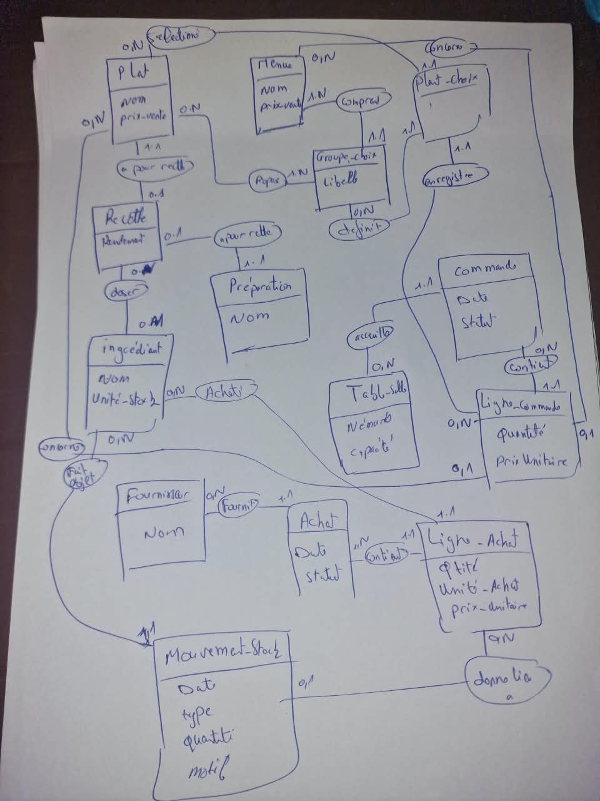

# Gestion d’un restaurant

Projet Symfony 7.4 pour le sujet 2 du PFE Challenge EMC. L’application doit couvrir la carte, les commandes en salle, la cuisine, les achats et les stocks.

## Lancer le projet

Lance `docker compose up --build` à la racine du dépôt, puis ouvre [la carte](http://127.0.0.1:8080/). Le [guide d’installation](INSTALL.md) contient les comptes, l’installation locale et les commandes de dépannage.

## Niveaux réalisés

| Niveau | Fonctions |
|---|---|
| 1 | Entités et migrations Doctrine, back-office, 20 plats, 50 ingrédients, 3 fournisseurs, 2 menus et 60 couverts en démonstration |
| 2 | Réservation, sortie de stock au service, conversions, achats, pertes, inventaire et tests MySQL |
| 3 | Comptes gérant, serveur et cuisine, prise de commandes, suivi des plats, ventes, marge et réapprovisionnement |
| 4 | Recherche par code-barres dans Open Food Facts, validation et affichage des allergènes sur la carte |
| 5 | Démarrage Docker Compose avec MySQL, migrations et données de démonstration |

Les plats sans recette complète sont indisponibles. Les données allergènes sans confirmation sont signalées sur la carte. La gestion des lots, des stocks de préparations et la tarification pondérée des menus restent des extensions possibles.

## Modèle conceptuel de données

## Choix de conception

- **Recettes et préparations** · Une recette décrit un plat ou une préparation. Une préparation, comme une sauce maison, peut être réutilisée dans plusieurs recettes avec une dose différente pour chacune.
- **Menus et commandes** · Les groupes de choix décrivent ce que propose le menu. La commande enregistre les plats réellement sélectionnés et le prix appliqué sur chaque ligne.
- **Achats et stock** · Les lignes d’achat conservent les quantités et les prix par ingrédient. Les mouvements retracent les entrées et les sorties dans l’unité de référence de chaque ingrédient.

Les règles et les compléments au dessin sont détaillés dans le [modèle de données](docs/MODELE.md).
