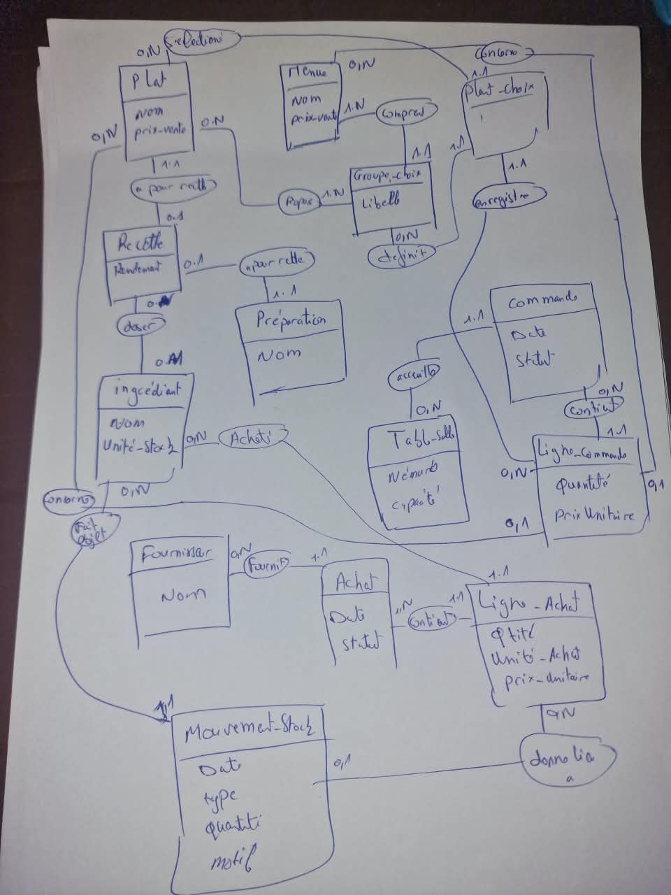

# Modèle de données du restaurant

## MCD

## Choix de conception

- **Recettes** · Chaque plat ou préparation possède sa propre recette. Le rendement indique la quantité produite. L’association « dose un ingrédient » porte la quantité et l’unité utilisées.
- **Préparations réutilisables** · Le dessin relie la préparation à sa propre recette. Il faut y ajouter l’association « utilise une préparation » entre la recette d’un plat et la préparation consommée. Elle porte la quantité et l’unité. Par exemple, une pizza peut utiliser 80 g d’une sauce dont la recette produit 1 kg.
- **Menus** · Un menu comporte des groupes comme « Entrée » ou « Dessert », chacun avec ses plats autorisés. Pour une ligne de menu, `Plat choisi` mémorise le plat sélectionné dans chaque groupe.
- **Commandes** · La commande regroupe les articles d’une table. Chaque ligne concerne un plat à la carte ou un menu et garde la quantité et le prix unitaire appliqué.
- **Achats** · Un achat est rattaché à un fournisseur. Chaque ligne d’achat détaille l’ingrédient, la quantité, l’unité d’achat et le prix unitaire.
- **Stock** · Le stock courant se calcule en faisant la somme des entrées moins les sorties. Les mouvements utilisent l’unité de référence de l’ingrédient. Une entrée liée à une ligne d’achat concerne le même ingrédient que cette ligne.

## Évolution pour le service, l’inventaire et les allergènes

- **Compte** · Un identifiant unique, un mot de passe haché et un rôle parmi gérant, serveur et cuisine.
- **PlatService** · Chaque ligne de commande produit un ou plusieurs plats à servir. Chaque plat à servir référence le plat du catalogue, mémorise les quantités d’ingrédients réservées et conserve le prix et le coût utilisés pour les ventes.
- **Inventaire** · Chaque comptage référence un ingrédient et garde le stock théorique et le stock compté. Un mouvement de stock enregistre l’ajustement.
- **ProduitAchete** · Une fiche identifiée par son code-barres est rattachée à un ingrédient. Une ligne d’achat peut référencer cette fiche. Le statut de vérification détermine ce qui est affiché sur la carte.

Les clés et contraintes physiques se trouvent dans les migrations Doctrine. Les décisions métier sont détaillées dans [DECISIONS.md](DECISIONS.md).
